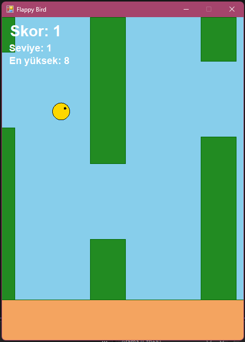
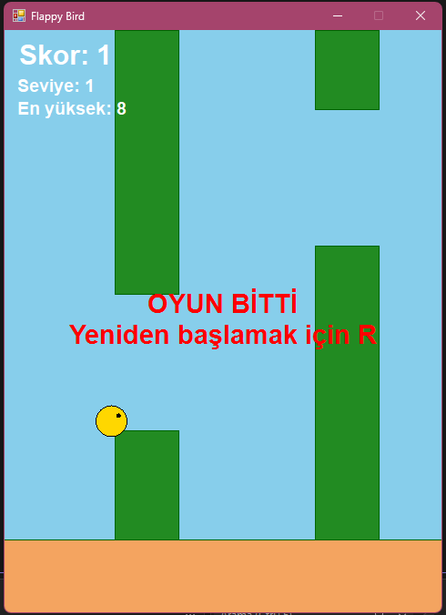

# YMH219-FlappyBird

Windows Forms ile yapılmış Flappy Bird benzeri bir oyun. YMH219 Nesne Tabanlı Programlama dersi ödevi olarak hazırlanmıştır.

**Ad Soyad:** Muhammed Eren Yaprakcı

**Öğrenci No:** 250542006

## Proje Amacı

Nesne tabanlı programlama kavramlarını (sınıf, nesne, kapsülleme) küçük bir oyun üzerinde uygulamaktır. Oyunda kuş, engeller, skor ve oyun durumu ayrı sınıf ve metotlarla yönetilir.

## Kullanılan Teknolojiler

* C#
* Windows Forms (.NET Framework 4.7.2)
* Visual Studio
* Git

## Çalıştırma Adımları

1. Repoyu klonlayın.
2. `YMH219-FlappyBird.slnx` dosyasını Visual Studio ile açın.
3. `F5` tuşuyla projeyi derleyip çalıştırın.

## Nasıl Oynanır

* **Space:** Kuşu zıplatır.
* **R:** Oyun bittikten sonra oyunu yeniden başlatır.
* Engellerin boşluğundan geçerek skor kazanın. Boruya veya zemine çarpınca oyun biter.

## Özellikler

* Yer çekimi ve Space tuşuyla zıplama
* Zemin ve tavan sınırı
* Sağdan sola hareket eden, boşluğu rastgele belirlenen engeller
* Engel ve zemin çarpışma kontrolü
* Skor ve seviye gösterimi
* Seviye arttıkça engellerin hızlanması
* En yüksek skorun `highscore.txt` dosyasında saklanması
* Game Over ekranı ve R ile yeniden başlatma

## Sınıf Yapısı

* `Bird`: Kuşun konumu, hızı, zıplaması ve çizimi
* `Pipe`: Engelin hareketi, rastgele boşluğu, çarpışma kontrolü ve çizimi
* `HighScore`: En yüksek skorun dosyadan okunması ve yazılması
* `Form1`: Olaylar, oyun döngüsü, skor ve oyun durumu

## Bilinen Sınırlamalar

* Kuş ve engeller basit şekillerle çizilmiştir, ses ve animasyon yoktur.
* Çarpışma kontrolü kuşun kare sınırına göre yapılır, bu yüzden köşelerde biraz payı olabilir.
* Oyun penceresi sabit boyutludur.
* En yüksek skor dosyası yazılamazsa skor kaydedilmez, oyun devam eder.

## Ekran Görüntüleri

<!-- Ekran görüntülerini docs klasörüne ekleyip aşağıdaki satırları güncelleyin -->

